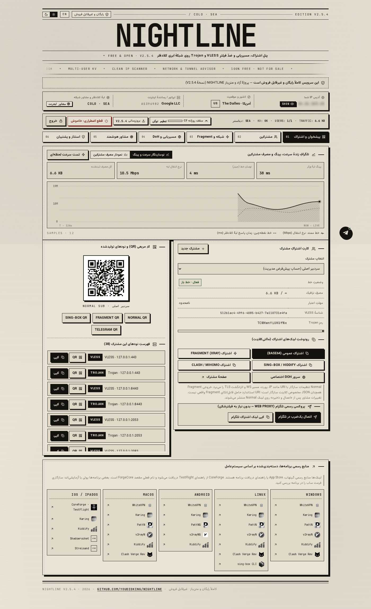
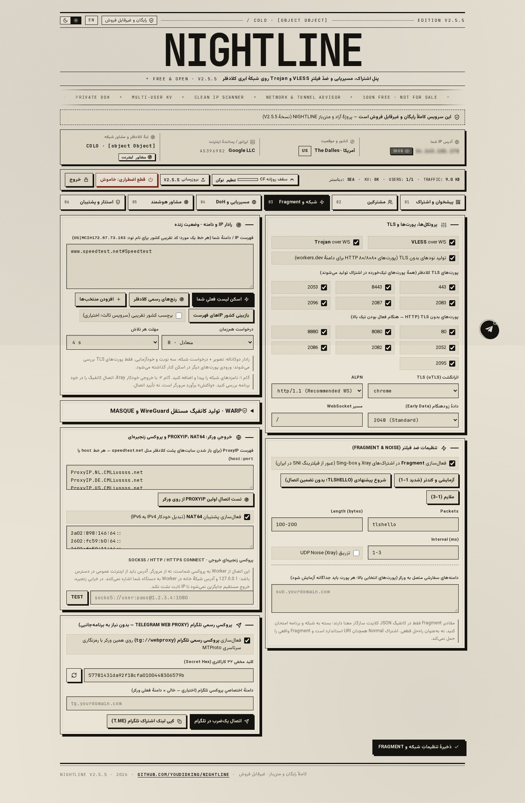
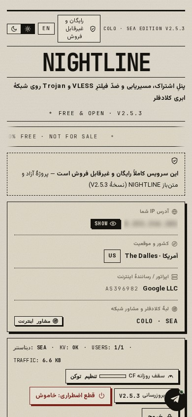

<div dir="rtl" align="right">

# 🌙 NIGHTLINE — نسخهٔ ۲.۵.۳

<p align="center">
  <strong>۱۰۰٪ رایگان — متن‌باز، غیرتجاری و غیرقابل فروش</strong>
</p>

<p align="center">
  <a href="https://wild-hall-a780.gigity.workers.dev/"><strong>🚀 نصب رایگان و آسان NIGHTLINE ↗</strong></a>
</p>

<p align="center">
  
  
  
  
</p>

---

## 📦 دربارهٔ پروژه

پنل رایگان و غیرتجاری روی **Cloudflare Workers**، با رابط فارسی/انگلیسی، پشتیبانی از **VLESS**، **Trojan** و **اشتراک چندکاربره**.

📄 [مجوز استفاده](LICENSE)

---

## 🗂️ کدام فایل را استفاده کنم؟

| فایل | کاربرد |
|:---|:---|
| 📄 `worker-single-file.js` | خود پنل؛ برای ارتقای Worker موجود یا نصب دستی |
| ⚙️ `nightline-installer.js` | نصب‌کنندهٔ مستقل؛ ساخت پنل جدید با توکن Cloudflare |

> ⚠️ **برای ارتقای پنل موجود:** پشتیبان بگیرید، کد `worker-single-file.js` را جایگزین و اتصال KV فعلی را حفظ کنید.
> ❌ نصب‌کنندهٔ مستقل، کاربران پنل قبلی را منتقل **نمی‌کند**.

---

## ⚡ نصب آسان — تمام مراحل در یک صفحه

<p align="center">
  <a href="https://wild-hall-a780.gigity.workers.dev/"><strong>🔗 بازکردن نصب‌کنندهٔ رسمی و آماده ↗</strong></a>
</p>

**۱.** لینک بالا را باز کنید؛ ساخت سایت نصب‌کننده یا KV از قبل لازم نیست.

**۲.** «ساخت توکن آماده» را بزنید و توکن **Cloudflare** بسازید؛ ⚠️ توکن GitHub برای نصب نیست.

**۳.** منابع توکن را به **یک اکانت** محدود و این مجوزها را تأیید کنید:

| مجوز | دسترسی |
|:---|:---|
| `Account Analytics` | Read |
| `Account Settings` | Read |
| `Workers Scripts` | Edit |
| `Workers KV Storage` | Edit |

**۴.** توکن را وارد و نصب را شروع کنید. شناسایی حساب، دانلود آخرین نسخهٔ رسمی، ساخت KV، تعیین مدیریت، ارسال Worker، انتشار و بررسی نتیجه **به‌صورت زنده در همان صفحه** نمایش داده می‌شوند. خطاهای توکن یا مجوز نیز همان‌جا اعلام می‌شوند.

**۵.** آدرس و گذرواژهٔ تولیدشده را ذخیره کنید؛ دکمه‌های کپی، ذخیرهٔ فایل اطلاعات ورود و ورود به پنل در همان صفحه هستند.

> ⏳ در انتظار انتشار KV/DNS، نصب را **دوباره اجرا نکنید**.

**۶.** بعد از اطمینان از ورود، توکن نصب را لغو کنید. اگر نصب‌کنندهٔ شخصی ساخته‌اید، Worker نصب‌کنندهٔ خودتان را نیز حذف کنید.

> 🔒 توکن نصب در پنل ذخیره نمی‌شود؛ آمار و خودآپدیت را در صورت نیاز جداگانه در پنل تنظیم کنید.

📝 نام Worker جدید: `nightline-free-RANDOM` — زیردامنهٔ فعلی حساب عوض نمی‌شود.

---

## 🛠️ نصب‌کنندهٔ شخصی

یک Worker خالی بسازید، کد `nightline-installer.js` را جایگزین و **Deploy** کنید. همین مراحل در سایت شخصی شما اجرا می‌شوند؛ KV آماده لازم نیست.

---

## 🔄 منبع نسخه و به‌روزرسانی

هر نصب، آخرین **Release پایدار** در [مخزن رسمی](https://github.com/youdidking/NightLine) و فایل `worker-single-file.js` آن را تازه دریافت می‌کند؛ کد پنل داخل نصب‌کننده نیست.

- ✅ **SHA-256** انتشار بررسی می‌شود.
- 🔍 در نبود digest، فایل با سورس همان commit مقایسه می‌شود.
- 📥 فقط اگر Release یا فایل آن وجود نداشته باشد، آخرین commit شاخهٔ اصلی خوانده می‌شود.
- 🛑 خطای شبکه/هش، نصب را **قبل از ایجاد منابع** متوقف می‌کند؛ نسخهٔ تعبیه‌شده یا ذخیره‌شدهٔ جایگزین وجود ندارد.

> 🧑‍💻 **برای نگه‌دارنده:** با هر انتشار، فایل تازهٔ `worker-single-file.js` را به آخرین Release اضافه/جایگزین کنید؛ آپلود سورس به `main` به‌تنهایی asset انتشار قبلی را تازه نمی‌کند. برای اعمال این اصلاحات روی سایت آماده نیز کد نصب‌کنندهٔ همان سایت باید با فایل جدید جایگزین شود.

> 🔐 **امنیت:** توکن ویرایش Worker دسترسی حساس دارد؛ تنها در نشانی رسمی بالا یا نصب‌کنندهٔ شخصیِ بررسی‌شده وارد کنید و پس از نصب لغوش کنید. صفحه را هنگام نصب نبندید. در قطع ارتباط، پیش از تکرار نصب، منابع تازهٔ اکانت را بررسی کنید؛ پاک‌سازی خطاها بهترین‌تلاش است، نه تضمینی.

---

## 🖼️ تصاویر واقعی پنل

> 📸 تصاویر از اجرای واقعی پنل در Chromium، با دادهٔ آزمایشی و IP مخفی‌شده ثبت شده‌اند؛ طرح گرافیکی ساختگی نیستند.

### 🖥️ داشبورد دسکتاپ



### 📶 تنظیمات شبکه و اسکنر



### 📱 موبایل



---

## 📡 مشاور شبکه

با بازکردن تب مشاور، آزمون آغاز می‌شود؛ **قبل از تأیید، هیچ تنظیمی ذخیره نمی‌شود**.

| آزمون | توضیح |
|:---|:---|
| ⏱️ تأخیر پنل | پنج نمونه + گزارش میانه، نوسان و درصد درخواست‌های بی‌پاسخ |
| 🔌 WebSocket | رفت‌وبرگشت واقعی تا همین Worker |
| 🔒 پورت‌های TLS | بررسی پورت‌های همین دامنه، نه سایت دیگر |
| 📥 DoH و آپلود/دانلود | پاسخ معتبر DoH و سه نمونهٔ آپلود/دانلود محدود با نمایش تأخیر حین انتقال |
| 🎛️ کنترل | نوار پیشرفت، توقف آزمون، نمایش پیشنهادها و تغییرات دقیق پیش از اعمال |

> 💡 تنظیمات مرکزی در همهٔ ساب‌ها، در حد قابلیت هر فرمت منتشر می‌شوند. URI معمولی، Fragment واقعی یا همهٔ قواعد مسیریابی را حمل نمی‌کند؛ **Xray**، **Sing-box** و **Clash** باید با قابلیت هستهٔ خودشان استفاده شوند. بعد از اعمال، اشتراک‌ها را در برنامه تازه‌سازی کنید.

---

## 🌐 اسکن IP داخل مرورگر

اسکن لیست و رنج‌ها از **اینترنت همین مرورگر** با سه تلاش، هم‌زمانی محدود، توقف و مهلت انتخابی **۴، ۷ یا ۱۰ ثانیه** انجام می‌شود؛ 🐍 ابزار Python لازم نیست.

- 🏓 **پینگ HTTP پنل:** میانه و نوسان پاسخ واقعی `/api/ping`؛ مستقل از IPهای فهرست است.
- 🌍 **پاسخ IP/دامنه:** فقط تکمیل درخواست HTTP(S) برای اکثریت نمونه‌ها، زمان پاسخ مثبت می‌گیرد. پاسخ opaque یا redirect به معنی تأیید کامل تونل نیست.
- 🎯 **نامزد‌یابی تخمینی:** دست‌کم دو خطای سریع غیرآنی می‌توانند IP خام را «نامزد تخمینی ـ تأییدنشده» کنند؛ این روش صرفاً سرنخ بررسی است، نه اثبات دسترسی، TLS معتبر یا پینگ. حالت «فقط پاسخ واقعی» این تخمین را کنار می‌گذارد.
- 🔗 **HTTP خام:** فقط در صفحهٔ HTTP و پورت مناسب مرورگر قابل آزمون است؛ صفحهٔ HTTPS آن را به دلیل mixed content مسدود می‌کند. در سایت HTTPS از پورت TLS مانند **443** استفاده کنید. `no-cors` این محدودیت یا خطای گواهی را دور نمی‌زند.

> 🧹 نمایش تکراری `0/3` و مدت خطا حذف شده؛ به‌جای آن وضعیت کوتاه و راه اقدام نشان داده می‌شود. هیچ IPی صرفاً به‌خاطر خطا حذف نمی‌شود. مرورگر SNI دلخواه یا ICMP خام ندارد؛ اسکن، سلامت VLESS/Trojan را تضمین نمی‌کند. VPN/پروکسی فعال جزو مسیر اندازه‌گیری است؛ کشور تقریبی از سرویس ثالث و اختیاری است.

---

## 📱 برنامه‌ها

| برنامه | پلتفرم | وضعیت |
|:---|:---|:---|
| 🖥️ **WhiteVPN** | ویندوز، مک، لینوکس | متصل به مخزن دسکتاپ رسمی |
| 📱 **WhiteVPN** | اندروید | لینک جدا |
| 🍎 **CoreForge** | iOS | راهنمای دریافت TestFlight (نام فعلی مقصد: `ForgeCore`) |

> 🔗 همهٔ برنامه‌ها آیکون و فلش خروج از لینک دارند.

---

## 🧪 ساخت و آزمون

> ⚙️ **پیش‌نیاز:** Node.js نسخهٔ **۲۲ یا جدیدتر**.
> 🎨 فونت‌ها و آیکون‌ها محلی‌اند؛ نصب `fonttools[woff]` برای کوچک‌سازی فونت اختیاری است و در نبود آن فونت محلی اصلی استفاده می‌شود.

```bash
npm ci
npm run build
npx playwright install --with-deps chromium
npm test
npm run test:regression
npm run test:network
npm run test:releases
npm run test:installer
```

- 🏗️ `build` هر دو فایل پنل و نصب‌کننده را می‌سازد.
- 🗃️ فایل‌های واسطه داخل `.arena`، `dist` و `src/generated` هستند و برای آپلود گیت‌هاب لازم نیستند.
- 📦 فایل‌های آمادهٔ Worker و نصب‌کننده در ریشهٔ پروژه باقی می‌مانند.

**نصب از خط فرمان:**

| مورد | دستور / تنظیم |
|:---|:---|
| 🎛️ پنل اصلی | شناسهٔ KV خود را در `wrangler.toml` تنظیم کنید |
| ⚙️ نصب‌کننده | `npm run deploy:installer` |
| 📄 ساخت اختیاری Pages | `npm run build:pages` (خروجی در `dist`) |

---

## 🔗 لینک‌های مفید

- 📝 [یادداشت انتشار ۲.۵.۳](RELEASE_NOTES_v2.5.3.md)
- 🔬 [روش آزمون شبکه و منابع بررسی](docs/NETWORK_METHODS.md)
- 📊 [گزارش آزمون](TEST_REPORT_FA.md)
- 🎨 [منابع آیکون‌ها](docs/CLIENT_ASSETS.md)

---

## ⚠️ محدودیت‌ها

> ✅ آزمون‌های محلی، استقرار روی حساب واقعی شما یا عملکرد روی همهٔ اپراتورهای ایران را **تضمین نمی‌کنند**.
> 🌐 مرورگر نمی‌تواند بهترین پارامتر Fragment یا رفع قطعی فیلترینگ را اثبات کند.
> 📜 استفاده باید مطابق قوانین محل، شرایط Cloudflare و مجوز پروژه باشد.

---

<p align="center">
  <sub>🌙 NIGHTLINE — متن‌باز، غیرتجاری و رایگان</sub>
</p>

</div>
