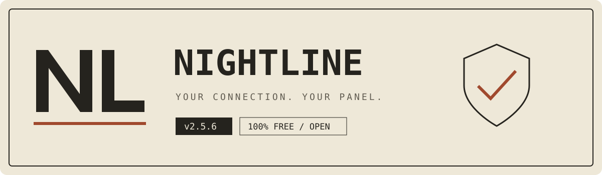

# نایت‌لاین | اتصال شما، پنل شما

### نسخهٔ ۲.۵.۸ — ۱۰۰٪ رایگان · FREE

**یک پنل فارسی و انگلیسی برای ساخت، مدیریت و تحویل اتصال آماده روی Cloudflare Workers و Pages.** بدون خرید سرور مجازی، با ظاهر روزنامه‌ای، حالت روشن و تاریک و رابط مناسب موبایل.

<a href="https://wild-hall-a780.gigity.workers.dev/"><strong>شروع نصب آسان ↗</strong></a> · <a href="https://github.com/youdidking/NightLine"><strong>مخزن رسمی ↗</strong></a>

---

## چه امکاناتی دارید؟

| بخش | آنچه در اختیار شماست |
| :--- | :--- |
| اتصال آماده | VLESS و Trojan با اشتراک چندفرمتی و QR |
| مدیریت کاربران | کاربر مستقل، لینک اختصاصی، مصرف و اعتبار |
| ابزار شبکه | اسکن IP و رنج از مسیر مرورگر، وضعیت رنگی و کشور تقریبی |
| مشاور ایران | بررسی اتصال و پیشنهاد تنظیمات، با تأیید شما |
| خروجی Worker | پشتیبان ProxyIP و پروکسی SOCKS5 / HTTP / HTTPS |
| امکانات تکمیلی | DNS خصوصی و پروکسی رسمی وب تلگرام |
| نگه‌داری آسان | پشتیبان، بروزرسانی و اعلان خودکار نسخهٔ جدید |

**قالب‌های معمول اشتراک:** Normal، Xray، Sing-box و Clash/Mihomo. هر قالب فقط قابلیت‌های پشتیبانی‌شدهٔ خودش را دریافت می‌کند.

## نصب در چند قدم

۱. **[نصب‌کنندهٔ آماده را باز کنید ↗](https://wild-hall-a780.gigity.workers.dev/)** و Workers یا Pages را انتخاب کنید.

۲. از راهنمای همان صفحه، توکن **Cloudflare** را بسازید و وارد کنید؛ توکن GitHub لازم نیست. توکن را فقط در سایت رسمی یا نسخهٔ شخصیِ بررسی‌شده وارد کنید.

۳. پیشرفت نصب و نتیجه در همان صفحه نمایش داده می‌شود. آدرس پنل و گذرواژهٔ مدیریت را در جای امن نگه دارید و پس از پایان نصب، توکن نصب را لغو کنید.

۴. وارد پنل شوید، کاربر بسازید و لینک اشتراک یا QR را به برنامهٔ سازگار بدهید.

**نصب دستی:** فایل `worker-single-file.js` برای Worker و بستهٔ `nightline-pages-update.zip` برای Pages است. فضای KV را با نام `KV` به پروژه متصل کنید. برای انتشار فایل Pages روی پروژهٔ موجود، همان اتصال KV را حفظ کنید.

## کشور در لینک و نام اتصال

کشور IPهای فهرست در **نام نود، عنوان اشتراک و لینک/QR کپی‌شده** قرار می‌گیرد. این بررسی IPv4 و IPv6 را پوشش می‌دهد و هنگام دریافت ساب تازه می‌شود. کدهای خودکار قدیمی در خطا دوباره به‌عنوان کشور معتبر استفاده نمی‌شوند.

- کشور، اطلاعات تقریبی **IP ورودی** است؛ نه اندازه‌گیری کشور خروجی پروکسی یا محل فیزیکی لبهٔ Cloudflare.
- برچسب `~` یعنی فقط یک منبع معتبر پاسخ داده است. `CC ?` یعنی نامعلوم یا اختلاف منابع. برچسب دستی با `manual` متمایز می‌شود.
- عنوان لینک جدید حاوی کشور است؛ تغییر نام خودکار گروهی که قبلاً وارد برنامه شده، به پشتیبانی همان برنامه بستگی دارد. نام نودها در محتوای تازهٔ ساب به‌روز می‌شود.
- برای جلوگیری از عبور از محدودیت Worker، در هر درخواست حداکثر ۱۲ IP خودکار تازه بررسی می‌شود؛ ادامهٔ فهرست در تازه‌سازی‌های بعدی پوشش می‌گیرد. پاسخ معتبر موقتاً کش می‌شود.

## چند نکتهٔ کاربردی

- **رنگ نتیجهٔ اسکن را درست بخوانید:** سبز پاسخ معتبر، قرمز تمام‌شدن مهلت همین تلاش، کهربایی نتیجهٔ ناپایدار/نامزد و خاکستری وضعیت نامعلوم است.
- کشور تقریبی است؛ عنوان و نام نودهای ساب هنگام تازه‌سازی بررسی می‌شوند. نمایش عنوان تازه به پشتیبانی برنامه از عنوان اشتراک هم بستگی دارد.
- IP خالی در بخش خروجی به‌عنوان ProxyIP قابل ثبت است. **IP به‌تنهایی، IP خروجی ثابت همهٔ سایت‌ها نمی‌سازد**؛ برای این هدف پروکسی واقعی لازم است.
- قبل از ارتقا پشتیبان بگیرید؛ **نصب دوباره، ارتقا نیست.** همان پروژه و KV را نگه دارید.
- خدمات Cloudflare محدودیت مصرف و شرایط استفاده دارند؛ رایگان‌بودن پنل به معنی منابع نامحدود نیست.

## فایل‌های بسته

فایل‌های آمادهٔ Worker، Pages و نصب‌کننده همراه سورس لازم برای ساخت، تنظیمات پروژه و مجوزها قرار دارند. گزارش‌های قدیمی، اسکرین‌شات‌ها، وابستگی‌های نصب‌شده و خروجی‌های موقت در بسته نیستند.

برای ساخت از سورس، Node.js 22 یا جدیدتر، Python 3 با `fonttools[woff]` و سپس `npm ci` و `npm run build:pages` لازم است. استفاده از فایل‌های آماده نیازی به این مرحله ندارد.

---

**نایت‌لاین رایگان، غیرتجاری و غیرقابل فروش است.** اعلان‌های رایگان‌بودن، مصرف و اعتبار بخشی ثابت از سرویس هستند. [مجوز پروژه](LICENSE)

