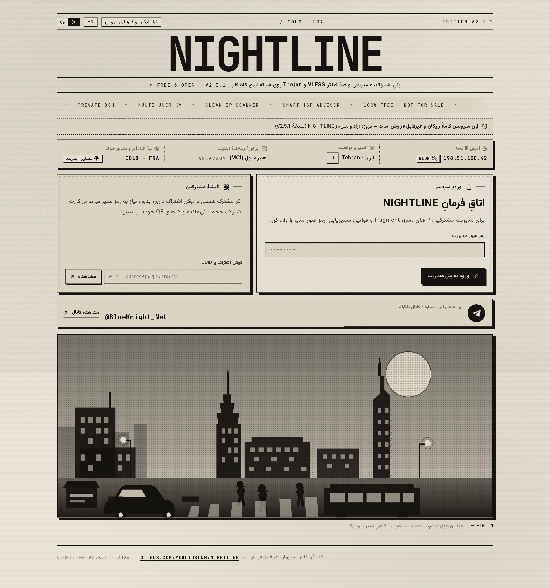
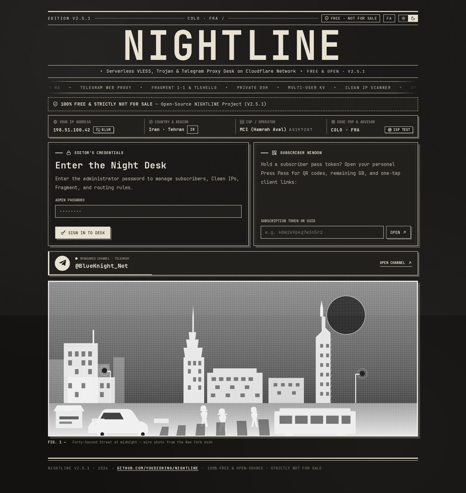

<div align="center">

# NIGHTLINE · V2.5.1

**پنل آزاد، رایگان و متن‌باز مدیریت اشتراک VLESS، Trojan و پروکسی رسمی تلگرام روی شبکهٔ ابری کلادفلر**  
*Free & Open-Source Serverless VLESS, Trojan, Fragment, Smart ISP Advisor, Live Monochrome Telemetry, Private DoH & Official Telegram Web Proxy Panel on Cloudflare Workers & Pages*

[](#)
[](#)
[](#اطلاعیه-مهم-رایگان-و-غیرقابل-فروش)

</div>

[یادداشت انتشار V2.5.1 / Release Notes](RELEASE_NOTES_v2.5.1.md) · [مخزن رسمی / Official Repository](https://github.com/youdidking/NightLine)

---

> ### اطلاعیهٔ مهم (رایگان و غیرقابل فروش)
> پروژهٔ **NIGHTLINE** یک نرم‌افزار **کاملاً رایگان، آزاد و متن‌باز (Open-Source)** است. هرگونه خرید و فروش سورس، پنل یا لینک‌های اشتراک ساخته‌شده با این ابزار اکیداً ممنوع است.  
> **NIGHTLINE is 100% Free & Open-Source — Strictly Not For Sale.**

---

## پیش‌نمایش محیط پنل (Screenshots — V2.5.1)

### ۱. پیشخوان مدیریت — تم روزنامهٔ روشن (فارسی) با نوار شناسایی IP/اپراتور و نوسان‌نگار تک‌رنگ سرعت


### ۲. پیشخوان مدیریت — تم تاریک (انگلیسی) با مخفی‌سازی IP (`BLUR`) و نمودار هاشورخوردهٔ مصرف مشترکین


### ۳. مشاور هوشمند اینترنت مرورگر (`Smart ISP Advisor`) و اعمال خودکار تنظیمات اپراتور


### ۴. تنظیمات شبکه، پورت‌ها، اسکنر زندهٔ IP تمیز در مرورگر و پروکسی رسمی تلگرام


### ۵. صفحهٔ اختصاصی هر مشترک (`/sub/<token>`) و راهنمای سرور DoH اختصاصی (`/dns-query/<token>`)


### ۶. صفحهٔ ورود — نمایش در تم روشن فارسی و تم تاریک انگلیسی




---

## نسخهٔ `V2.5.1`

بهبودهای کلی رابط کاربری و رفع باگ‌ها.

---

## تازه‌های نسخهٔ `V2.5.0`

- **نوار فشردهٔ سقف درخواست روزانهٔ Cloudflare** در پیشخوان: نمایش درخواست‌های ثبت‌شدهٔ امروزِ **کل حساب**، آستانهٔ قابل تنظیم، درصد مصرف و زمان بازنشانی در نیمه‌شب UTC. گزارش از GraphQL کلادفلر خوانده می‌شود؛ بدون توکن، نوار به‌جای عدد ساختگی درخواست اتصال توکن را نشان می‌دهد.
- **راهنمای توکن و سطح دسترسی در همان پنل:** کادر کوچک «دسترسی‌های موردنیاز»، بررسی واقعی توکن پیش از ذخیره و امکان حذف توکن. مقدار توکن در فضای `KV` پنل ذخیره می‌شود؛ تنها برچسبِ پوشیده‌شدهٔ آن به رابط کاربری بازمی‌گردد. برای امنیت، توکن را فقط به حساب خودتان محدود کنید.
- **بررسی نسخه و بروزرسانی مستقیم ورکر:** دکمهٔ بروزرسانی در نوار وضعیت، نسخهٔ منتشرشده یا شاخهٔ اصلی [مخزن رسمی `youdidking/NightLine`](https://github.com/youdidking/NightLine) را بررسی می‌کند. با توکن دارای `Workers Scripts: Edit`، فایل اجرایی رسمی روی ورکر فعلی بارگذاری می‌شود و اتصال‌های `KV`، متغیرها، اسرار و تنظیمات سازگاری موجود نگه داشته می‌شوند. این بروزرسانی مستقیم برای **Cloudflare Workers** است؛ برای **Pages** فایل فشردهٔ جدید را مجدداً Deploy کنید.
- **رفع باگ مشترک تازه:** نوار حجم و نمودار برای کاربر با مصرف `0 B` واقعاً `0%` هستند؛ ایجاد شناسهٔ تکراری رد می‌شود و مصرف معلق هنگام ریست/تعویض کلید پاک می‌شود.
- **پرداخت بصری:** فاصلهٔ تب «مشاور هوشمند» با سایر تب‌ها برابر شده، توضیحات متای زائد و کلوفون فونت حذف شده و نوار وضعیت فارسی و انگلیسی در عرض دسکتاپ به‌صورت یک‌ردیفه نمایش داده می‌شود.
- **راستی‌آزمایی:** `15/15` سناریوی تست سرتاسری شامل API، تونل زنده، اتصال و سهمیهٔ Cloudflare با سرور ساختگی، بروزرسانی از GitHub با سرور ساختگی، مصرف مشترک تازه و ظاهر رابط با Playwright پاس شده است. این تست‌ها **استقرار واقعی روی حساب شما یا انتشار واقعی مخزن گیت‌هاب را انجام نمی‌دهند**.

### امکانات پایه از نسخه‌های پیشین

- **مشاور هوشمند اینترنت مرورگر و تنظیم خودکار (`Smart Browser ISP Advisor`):** بررسی زندهٔ وضعیت دسترسی مستقیم مرورگر شما به گوگل، سرویس‌های هوش مصنوعی (`ChatGPT`, `Claude`, `Gemini`)، گیت‌هاب، شبکه‌های اجتماعی (`YouTube`, `Telegram`, `X`)، سرورهای `DoH` و پورت‌های جایگزین کلادفلر؛ تشخیص نوع محدودیت اپراتور و اعمال خودکار بهینه‌ترین تنظیمات Fragment، پورت و مسیریابی با یک کلیک.
- **تشخیص خودکار IP، کشور و اپراتور بازدیدکننده + کلید مخفی‌سازی (`BLUR`):** نمایش فوری آدرس IP، کشور/شهر، اپراتور اینترنت (همراه اول، ایرانسل، مخابرات، شاتل، آسیاتک، رایتل و...) و دیتاسنتر کلادفلر به محض ورود به پنل همراه با دکمهٔ محوسازی آنی IP (`BLUR / SHOW`).
- **تلگراف و نمودار زندهٔ تک‌رنگ (`Monochrome Live Speed, RTT & Quota Chart`):** نوسان‌نگار ۶۰ فریم‌برثانیهٔ سرعت انتقال لبه (`Mbps`)، پینگ و جیتر (`ms`) + تست سرعت لحظه‌ای (`Burst Speed Test`) و نمودار ستونی هاشورخوردهٔ مصرف مشترکین، کاملاً وفادار به پالت تک‌رنگ روزنامه در هر دو تم روشن و تاریک.
- **سیستم آیکون‌های برداری اختصاصی و فیزیک دکمه‌های سایه‌ثابت:** حذف کامل ایموجی‌ها و جایگزینی با آیکون‌های برداری تک‌رنگ (`SVG Sprite`) و انیمیشن نرم دکمه‌ها با سایهٔ کاملاً ثابت روی کاغذ هنگام کلیک.
- **دو پروتکل همزمان بدون نیاز به سرور مجازی:** پشتیبانی همزمان از **VLESS** و **Trojan** روی WebSocket با مصرف پردازندهٔ بهینه‌شده برای پلن رایگان کلادفلر (`Free Tier`).
- **پروکسی رسمی تلگرام (`Telegram Web Proxy`):** پیاده‌سازی کامل پروتکل رسمی `tg://webproxy` (مبتنی بر MTProto سرتاسری) برای اتصال یک‌ضرب در **Telegram Desktop** و **Telegram Android** بدون نیاز به روشن کردن فیلترشکن.
- **مدیریت چندکاربره با فضای `KV`:** تعریف تا ۲۰۰ مشترک مجزا با سقف حجم مصرفی (`GB`)، تاریخ انقضا، شمارش اعتبار از **اولین اتصال واقعی (`Start on First Connect`)**، توقف موقت، ریست ترافیک و تعویض یک‌کلیکی کلیدها.
- **خروجی هوشمند چندکلاینته با یک لینک واحد:** تشخیص خودکار برنامه و تولید کانفیگ استاندارد برای **v2rayNG**، **MahsaNG**، **v2rayN**، **Hiddify**، **Sing-box**، **Clash Meta / Mihomo**، **Streisand** و **Shadowrocket**.
- **رفع کامل محدودیت سایت‌های پشت کلادفلر (مانند `speedtest.net`) و سرور `Private DoH`:** مجهز به بافر بازپخش چندفریمی (`Multi-Frame Replay`)، لیست `ProxyIP` و `NAT64` و سرور اختصاصی `/dns-query/<token>` سازگار با `RFC 8484` و `JSON DNS`.

---

## راهنمای سقف روزانهٔ Cloudflare و توکن API (`V2.5.0`)

1. در پنل، روی نشان **سقف روزانه CF** کلیک کنید و سپس گزینهٔ «دسترسی‌های موردنیاز» را باز کنید. برای ساخت توکن وارد [Cloudflare API Tokens](https://dash.cloudflare.com/profile/api-tokens) شوید و **Create Custom Token** را بزنید.
2. در محدودهٔ **حساب خودتان** این دسترسی‌ها را به توکن بدهید: `Account · Account Analytics · Read` برای نمودار تعداد درخواست‌ها؛ `Account · Account Settings · Read` برای پیدا کردن شناسهٔ حساب؛ و اگر قصد بروزرسانی درون پنل دارید، `Account · Workers Scripts · Edit` نیز برای ورکر مقصد. سطح `Edit` برای **فقط خواندن سهمیه** لازم نیست. به [راهنمای رسمی ساخت توکن](https://developers.cloudflare.com/fundamentals/api/get-started/create-token/) مراجعه کنید.
3. توکن را در کادر پنل بچسبانید، نام دقیق ورکر را (اگر خودکار تشخیص داده نشد) وارد کنید و **بررسی اتصال توکن** و سپس **ذخیره و فعال‌سازی** را بزنید. درخواست‌های GraphQL امروز و نام حساب به‌طور زنده بررسی می‌شوند. توکن در `KV` همان پنل ذخیره می‌شود، نه در URL یا خروجی عمومی. برای قطع دسترسی از همین پنجره توکن را حذف یا از داشبورد Cloudflare باطل کنید.
4. عدد **۱۰۰٬۰۰۰ درخواست در روز** یک **آستانهٔ پیش‌فرض قابل تنظیم برای نمایش در پنل** است، نه تضمین سقف رسمی یا باقی‌ماندهٔ واقعی پلن Cloudflare شما. عدد نمایش‌داده‌شده مجموع درخواست‌های ورکرهای حساب در روز جاری UTC است؛ آمار Cloudflare ممکن است با تأخیر به‌روزرسانی شود. شمارنده در `00:00 UTC` بازنشانی می‌شود و داده‌ها برای کاهش فراخوانی API حدود ۴۵ ثانیه در حافظه ذخیره می‌گردند.

### بروزرسانی با یک کلیک از مخزن رسمی (فقط Workers)

1. پیش از بروزرسانی، برای اطمینان از داده‌های مشترکین از تنظیمات پنل **نسخهٔ پشتیبان** بگیرید. ابتدا توکن دارای `Workers Scripts: Edit` را مطابق راهنمای بالا ثبت کنید.
2. در پیشخوان روی **بروزرسانی** بزنید. **بررسی نسخهٔ جدید** انتشارهای مخزن `https://github.com/youdidking/NightLine` و سپس در صورت لزوم `main/package.json` را می‌خواند. در صورت عدم انتشار نسخه یا فایل اجرایی در مخزن، بروزرسانی درون پنل انجام نمی‌شود.
3. نام **ورکر مقصد** را تأیید و **بروزرسانی مستقیم پنل** را بزنید. پنل `worker-single-file.js` رسمی را دریافت می‌کند و قبل از جایگزینی کد، اتصال‌های موجود `KV`، متغیرها، اسرار و تنظیمات سازگاری ورکر را از Cloudflare می‌خواند و در درخواست بارگذاری مجدد به‌همراه کد جدید حفظ می‌کند. پس از پایان، صفحه را تازه‌سازی کنید. امکان بروزرسانی مستقیم Pages از این مسیر وجود ندارد؛ از `nightline-pages.zip` جدید استفاده کنید.

---

## آموزش نصب گام‌به‌گام (بدون نیاز به سرور یا دانش برنامه‌نویسی)

شما می‌توانید **NIGHTLINE** را به یکی از ۳ روش زیر در کمتر از ۳ دقیقه راه‌اندازی کنید. ساده‌ترین و پیشنهادی‌ترین روش، **روش اول (از طریق داشبورد کلادفلر)** است.

---

### روش اول (پیشنهادی): نصب روی Cloudflare Workers از طریق مرورگر

#### گام ۱ — ساخت فضای ذخیره‌سازی `KV`
1. وارد حساب کاربری خود در [داشبورد کلادفلر](https://dash.cloudflare.com) شوید.
2. از منوی سمت چپ وارد بخش **Storage & Databases** و سپس **KV** شوید.
3. روی دکمهٔ **Create a namespace** کلیک کنید، یک نام دلخواه (مثلاً `nightline-kv`) وارد کنید و روی **Add** بزنید.

#### گام ۲ — ساخت ورکر و قرار دادن کد
1. از منوی سمت چپ وارد **Compute (Workers) → Workers & Pages** شوید و روی **Create** کلیک کنید.
2. حتماً گزینهٔ **Start with Hello World!** را انتخاب کنید (از گزینهٔ Import a repository استفاده نکنید).
3. یک نام دلخواه برای ورکر انتخاب کرده و روی **Deploy** کلیک کنید.
4. پس از ساخته شدن ورکر، روی دکمهٔ **Edit code** در بالای صفحه کلیک کنید.
5. تمام محتویات پیش‌فرض فایل `worker.js` موجود در ادیتور کلادفلر را پاک کنید، محتویات فایل آمادهٔ **`worker-single-file.js`** موجود در همین مخزن را کامل کپی کرده و در ادیتور جای‌گذاری (`Paste`) کنید.
6. روی دکمهٔ **Deploy** در گوشهٔ بالا سمت راست کلیک کنید.

#### گام ۳ — اتصال `KV` و بررسی تاریخ سازگاری (`Compatibility Date`)
1. به صفحهٔ اصلی ورکر برگردید و وارد تب **Settings** شوید.
2. در بخش **Bindings** روی **Add** کلیک کنید و گزینهٔ **KV Namespace** را انتخاب نمایید:
   - در کادر **Variable name** دقیقاً عبارت زیر را با حروف بزرگ بنویسید:
     ```text
     KV
     ```
   - در کادر **KV namespace** فضایی که در گام ۱ ساختید (`nightline-kv`) را انتخاب کرده و **Deploy / Save** را بزنید.
3. در همان تب **Settings**، بخش **Compatibility Date** را بررسی کنید که روی تاریخ جدید (`2024-09-23` یا جدیدتر، مثلاً `2026-04-01`) قرار داشته باشد.

#### گام ۴ — ورود اولیه و تنظیم رمز مدیریت
1. آدرس ورکر خود (یا دامنهٔ شخصی متصل‌شده) را در مرورگر باز کنید.
2. صفحهٔ **راه‌اندازی نخستین شماره** نمایش داده می‌شود؛ یک رمز عبور مدیریتی (حداقل ۶ کاراکتر) انتخاب کنید و روی **افتتاح تحریریه و ورود به پنل** بزنید.
3. پنل شما آمادهٔ استفاده است! لینک‌های اشتراک، QR کدها، مشاور هوشمند شبکه، سرور DoH و پروکسی رسمی تلگرام بلافاصله در دسترس هستند.

---

### روش دوم: نصب روی Cloudflare Pages (آپلود فایل فشرده)

1. در داشبورد کلادفلر یک فضای `KV` بسازید (مانند گام ۱ بالا).
2. وارد **Workers & Pages → Create → تب Pages → Upload assets** شوید.
3. یک نام برای پروژه انتخاب کنید و فایل آمادهٔ **`nightline-pages.zip`** موجود در مخزن را مستقیماً آپلود و **Deploy** کنید.
4. وارد **Settings → Functions** پروژهٔ Pages شوید:
   - در بخش **Compatibility date** تاریخ `2026-04-01` (یا جدیدتر از `2024-09-23`) را ثبت کنید.
   - در بخش **KV namespace bindings** یک اتصال با نام متغیر `KV` به فضای KV ساخته‌شده اضافه کنید.
5. یک بار دیگر فایل `nightline-pages.zip` را از تب **Deployments → Create new deployment** بارگذاری کنید تا تنظیمات KV اعمال شود.

---

### اتصال دامنهٔ شخصی (Custom Domain — بسیار پیشنهادی)

از آنجا که دامنهٔ پیش‌فرض `*.workers.dev` روی برخی اپراتورها فیلتر است و کلادفلر روی آن فقط پورت‌های `443` و `80` را باز می‌گذارد، اتصال یک دامنه یا ساب‌دامنهٔ شخصی مزایای زیر را فعال می‌کند:
- باز شدن کامل پنل، اشتراک‌ها و **پروکسی رسمی تلگرام (`tg://webproxy`)** بدون نیاز به هیچ فیلترشکنی.
- فعال شدن تمامی **۶ پورت TLS** (`443, 8443, 2053, 2083, 2087, 2096`) و **۷ پورت HTTP** کلادفلر.

---

### روش سوم: بیلد از سورس و استقرار با Wrangler CLI (مخصوص توسعه‌دهندگان)

پیش‌نیاز: نصب بودن **Node.js 20+**.

```bash
git clone https://github.com/youdidking/NightLine.git
cd nightline
npm install
npm run build
npm run dev
```

---

## راهنمای اتصال در کلاینت‌ها

| برنامه / پلتفرم | لینک پیشنهادی برای کپی از پنل | توضیح |
| :--- | :--- | :--- |
| **v2rayNG / MahsaNG / v2rayN** (با ضد فیلتر Fragment) | دکمهٔ **اشتراک Fragment (Xray)** | لینک را در بخش *Subscription Group* برنامه اضافه و آپدیت کنید. |
| **Hiddify / Sing-box** (اندروید، ویندوز، iOS، مک) | دکمهٔ **اشتراک Sing-box / Hiddify** | شامل پروفایل کامل مسیریابی ایران و انتخاب خودکار سریع‌ترین نود. |
| **Clash Meta / Mihomo / FlClash** | دکمهٔ **اشتراک Clash / Mihomo** | فایل YAML کامل با گروه `Auto Best` و قوانین مسیریابی. |
| **Streisand / V2Box / Shadowrocket / کلاینت‌های عمومی** | دکمهٔ **اشتراک عمومی (Base64)** | سازگار با تمامی برنامه‌های استاندارد VLESS و Trojan. |
| **Telegram Desktop & Telegram Android** | دکمهٔ **اتصال یک‌ضرب در تلگرام** | پروکسی رسمی تلگرام (`tg://webproxy`) بدون نیاز به اجرای VPN. |
| **مرورگرهای Chrome / Brave / Edge / Firefox** | دکمهٔ **سرور DoH اختصاصی** | قرار دادن در بخش *Secure DNS / DNS over HTTPS* مرورگر برای رفع تحریم و مسمومیت DNS. |

---

## Quick Start (English)

**NIGHTLINE v2.5.1** is a 100% free, non-commercial, open-source serverless panel for **Cloudflare Workers & Pages**, combining **VLESS + Trojan over WebSocket**, **Xray & Sing-box TLS Fragmentation**, **Official Telegram Web Proxy (`tg://webproxy`)**, **Smart Browser ISP Advisor & 1-Click Auto-Tuner**, **Visitor IP/Country/ISP Detection with Privacy Blur**, **Dynamic Monochrome Telemetry & Quota Charts**, and **RFC 8484 Private DoH**.

1. **Create a KV Namespace** in your Cloudflare Dashboard (`Storage & Databases → KV`) named `nightline-kv`.
2. **Create a Worker** (`Workers & Pages → Create → Start with Hello World! → Deploy → Edit code`), replace the editor contents with **`worker-single-file.js`**, and click **Deploy**.
3. **Bind KV:** Open Worker `Settings → Bindings → Add → KV Namespace`, set Variable name to **`KV`**, select `nightline-kv`, and save.
4. **Initialize:** Visit your Worker URL (or attached Custom Domain) in your browser to set your admin password and generate multi-client subscriptions & Telegram Web Proxy links immediately.
5. **Optional daily request counter:** Open **CF Daily** in the dashboard and create a scoped Cloudflare API Token with `Account Analytics: Read` and `Account Settings: Read`. Add `Workers Scripts: Edit` **only** if you want in-panel Worker updates. Verify and save the token in the panel. The default `100,000` is an editable **display threshold, not an assertion of your account's official Cloudflare plan limit**; the counter measures the account's UTC-day Worker requests.
6. **Optional Worker updater:** Open **Update**, check [`youdidking/NightLine`](https://github.com/youdidking/NightLine), confirm your target Worker name, and apply. The deployment preserves existing bindings and compatibility settings; make a backup first. **Pages users** should redeploy the new `nightline-pages.zip` instead. A published Worker bundle is required for this action.

Developers: run `npm ci && npm run build && npm test` (install Playwright Chromium and OS dependencies first when needed). The `15/15` E2E suites use local mock Cloudflare/GitHub APIs for token, quota, and updater flows; they do not make changes to a production Cloudflare account.

---

## مجوز انتشار (License)

این پروژه به‌صورت **متن‌باز و کاملاً رایگان** برای استفادهٔ شخصی و آموزشی منتشر شده است. استفادهٔ تجاری و خرید و فروش اشتراک یا سورس این پروژه مجاز نیست. به فایل [LICENSE](LICENSE) مراجعه کنید.
