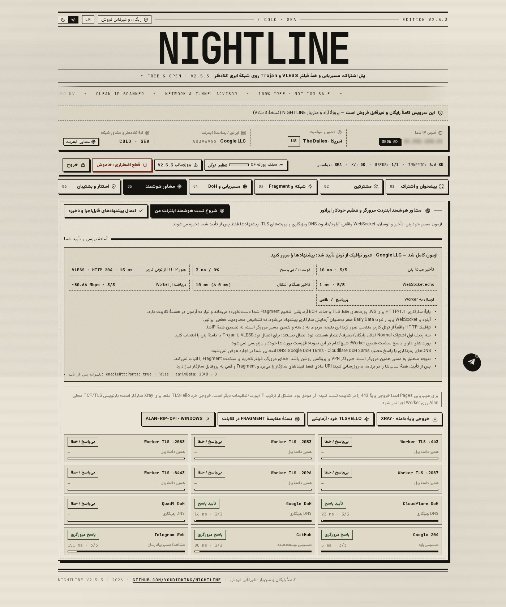
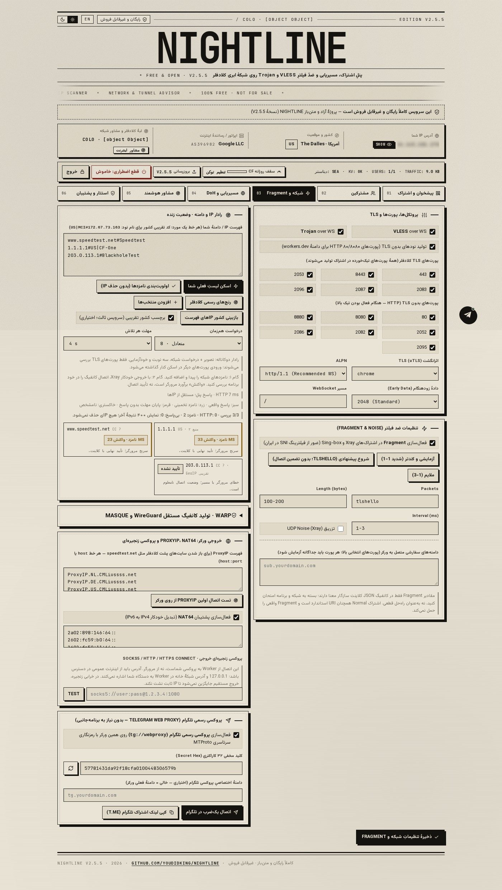
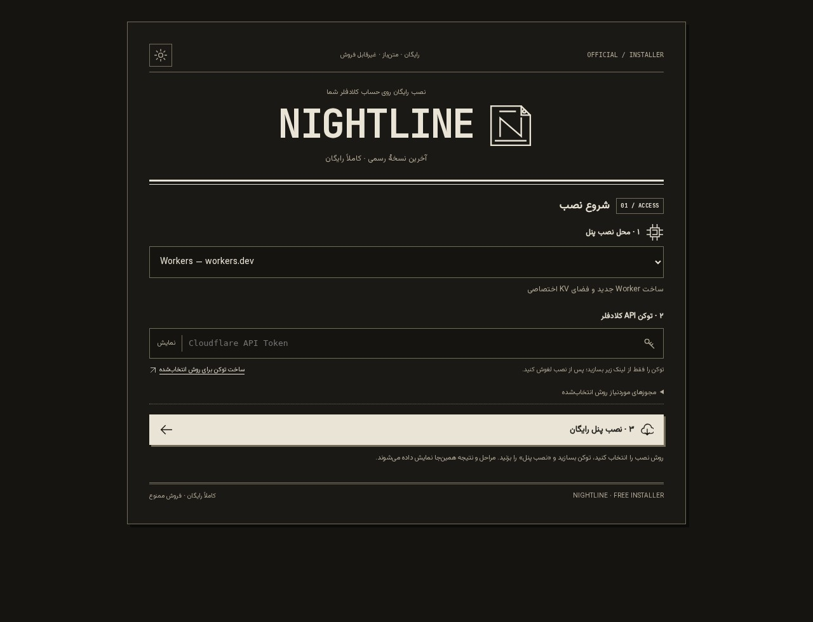

<div dir="rtl" align="right">

# 🌙 NIGHTLINE — نسخهٔ ۲.۵.۵

<p align="center">
  <strong>۱۰۰٪ رایگان — متن‌باز، غیرتجاری و غیرقابل فروش</strong>
</p>

<p align="center">
  <a href="https://wild-hall-a780.gigity.workers.dev/"><strong>🚀 بازکردن نصب‌کنندهٔ آسان ↗</strong></a>
</p>

<p align="center">
  
  
  
  
</p>

---

پنل فارسی/انگلیسی **VLESS** و **Trojan** روی **Cloudflare Workers** و **Pages**، با کاربران مستقل، اشتراک چندفرمتی، مصرف و اعتبار، DNS خصوصی و ابزار بررسی شبکه. 
📄 [مجوز استفاده](LICENSE)

---

## ✨ تازه‌های نسخهٔ ۲.۵.۵

- 🛠️ **اصلاح زنجیرهٔ اتصال:** اصلاح واقعی زنجیرهٔ SOCKS5 و HTTP/HTTPS CONNECT، احراز هویت و جلوگیری از fallback مستقیم هنگام خرابی زنجیره.
- 🎨 **رادار IP:** رنج‌های انتخابی، حجم اسکن آماده و حالت پیوسته؛ 🟢 سبز برای پاسخ واقعی، 🔴 قرمز برای مهلت بی‌پاسخ، 🟡 کهربایی/⚫ خاکستری برای عدم قطعیت.
- 🌍 **موقعیت جغرافیایی:** کشور با تطبیق دو پایگاه و حفظ برچسب کشور IPv4/IPv6 در نام کانفیگ؛ GeoIP آدرس Anycast جای مکان فیزیکی سرور نیست.
- 📡 **مشاور شبکه:** سه آزمون واقعی تونل و سیاست اختیاری سازگاری ایران؛ اعمال تنظیمات فقط با تأیید.
- ⚙️ **تولید کانفیگ:** تولید کانفیگ مستقل **WARP WireGuard** و **MASQUE H2/H3** با کلید محلی و پشتیبان محرمانه (نه سرور UDP ساختگی روی Worker).

🔗 [تغییرات کامل](RELEASE_NOTES_v2.5.5.md) · [روش‌ها و محدودیت‌ها](docs/NETWORK_METHODS.md) · [گزارش آزمون](TEST_REPORT_FA.md)

---

## 🗂️ کدام فایل برای من است؟

| فایل | کاربرد |
|:---|:---|
| 📄 `worker-single-file.js` | کد آمادهٔ پنل؛ برای نصب دستی یا ارتقای Worker موجود |
| ⚙️ `nightline-installer.js` | سایت نصب عمومی با منوی Workers / Pages؛ شمارهٔ نسخهٔ ثابت ندارد |
| 📦 `nightline-pages-update.zip` | انتشار نسخهٔ تازه روی پروژهٔ Pages موجود؛ فایل کاربران نیست |

> ⚠️ **Pages موجود:** یک Deployment تازه روی همان پروژه بسازید و KV را حفظ کنید. ابزار خودآپدیت و آمار داخلی فعلی به Workers متکی است؛ آن را مدیریت کامل Pages فرض نکنید.

> 💡 **ارتقا با نصب تازه فرق دارد:** قبل از ارتقا پشتیبان بگیرید. پروژه و KV فعلی را نگه دارید. نصب دوباره با نصب‌کنندهٔ آسان، پروژه و KV تازه می‌سازد و کاربران قبلی را منتقل نمی‌کند.

---

## ⚡ نصب آسان؛ همهٔ مراحل در همان صفحه

**۱.** [نصب‌کنندهٔ آماده](https://wild-hall-a780.gigity.workers.dev/) را باز کنید و **Workers** یا **Pages** را انتخاب کنید.

**۲.** «ساخت توکن برای روش انتخاب‌شده» را بزنید. توکن باید **Cloudflare** باشد، نه GitHub. منابع آن را به یک اکانت محدود کنید:

| مجوز | دسترسی |
|:---|:---|
| `Account Settings` | Read |
| `Account Analytics` | Read |
| `Workers KV Storage` | Edit |
| `Workers Scripts` (برای Workers) | Edit |
| `Cloudflare Pages` (برای Pages) | Edit |

*(لینک آماده برای Pages از کلید `page` استفاده می‌کند).*

**۳.** توکن را وارد و نصب را شروع کنید. شناسایی حساب، دریافت کد، ساخت فضای ذخیره‌سازی، تعیین مدیریت، انتشار و نتیجه در همان صفحه نمایش داده می‌شوند.

> 🛑 **هشدار:** صفحه را نبندید. اگر ارتباط قطع شد، پیش از تکرار نصب، منابع تازهٔ حساب را بررسی کنید.

**۴.** آدرس و گذرواژهٔ تولیدشده را ذخیره کنید. پس از اطمینان از ورود، توکن نصب را لغو کنید. فقط اگر سایت نصب‌کننده متعلق به خودتان است می‌توانید آن را حذف کنید؛ سایت عمومی پروژه را حذف نکنید.

📝 نام پنل تازه: `nightline-free-RANDOM` (در نصب تازهٔ Pages، پایهٔ سازگاری 443، HTTP/1.1 و Early Data صفر ثبت می‌شود. این به معنی مسدودبودن همهٔ پورت‌های دیگر نیست).

> 🛠️ **سایت نصب شخصی:** کد `nightline-installer.js` را روی یک Worker خالی Deploy کنید؛ KV آماده لازم نیست. توکن دسترسی حساس دارد؛ آن را تنها در سایت رسمی یا نسخهٔ شخصیِ بررسی‌شده وارد کنید. توکن نصب در مرورگر یا پنل ذخیره نمی‌شود.

### 🔄 دریافت نسخه از مخزن

هر نصب، `worker-single-file.js` را مستقیم از ریشهٔ شاخهٔ `main` مخزن رسمی می‌گیرد؛ وابسته به GitHub REST API، فایل ZIP در Release یا توکن GitHub نیست. نسخه از همان فایل خوانده می‌شود و کد پنل داخل نصب‌کننده نیست. حجم و ساختار اولیه کنترل می‌شوند. SHA-256 شناسهٔ فایل است، نه امضای مستقل؛ اعتماد به HTTPS و مخزن رسمی است. قطعی یا کش مبدأ همچنان ممکن است.

> 🧑‍💻 **برای نگه‌دارنده:** ابتدا فایل آمادهٔ جدید را در `main` قرار دهید؛ صرف آپلود سورس یا ZIP، فایل اجرایی قبلی را تازه نمی‌کند. برای تغییر ظاهر سایت نصب نیز کد Worker نصب‌کننده را جداگانه جایگزین کنید.

---

## 🌐 رادار IP: از اسکن تا اتصال واقعی

این بخش در خود صفحه اجرا می‌شود؛ اسکن از سرور خارجی جایگزین اینترنت شما نشده است.

**۱.** در تب شبکه، فهرست خود را بررسی کنید یا از رنج‌های رسمی کلادفلر نمونه بگیرید. رادار سه نوبت از **تصویر + درخواست شبکه** استفاده می‌کند و آدرس‌های کنترل را نیز می‌آزماید.

**۲.** رنگ و نوع نتیجه را اشتباه نگیرید:

- 🟢 **سبز / پاسخ HTTP:** مرورگر واقعاً درخواست HTTP(S) را تکمیل کرده است؛ هنوز سلامت کل کانفیگ ثابت نشده است.
- 🎯 **نامزد / واکنش:** سرنخ زمانی مرورگر برای آزمون در برنامه؛ ممکن است از خطای گواهی یا قطع اتصال آمده باشد. این عدد پینگ قطعی یا تأیید اتصال نیست.
- 🔴 **قرمز:** یعنی پایان مهلت همین آزمون، نه اثبات فیلترینگ.
- 🟡 **کهربایی:** یعنی نامزد یا HTTP ناپایدار.
- ⚫ **خاکستری:** یعنی وضعیت نامعلوم. 

رنج‌ها را انتخاب و حجم کل یا حالت پیوسته را تعیین کنید؛ تایپ تعداد برای تک‌تک رنج‌ها لازم نیست. توقف/هم‌زمانی ایمن حفظ شده است. ذخیرهٔ IP و تعداد نود خروجی سقف مستقل دارند.

**۳.** نامزدهای دلخواه را اضافه یا اولویت‌بندی و با دکمهٔ **ذخیرهٔ تنظیمات شبکه** ثبت کنید. خطا باعث حذف خودکار IPهای شما نمی‌شود.

**۴.** در مشاور، **«انتخاب خودکار IP و Fragment در Xray»** را بزنید و JSON کامل را در برنامهٔ سازگار با Xray وارد و فعال کنید. اینجا اتصال واقعی مسیرها آزمایش می‌شود.

> ⚠️ فقط پورت‌های TLS در رادار مرورگر بررسی می‌شوند؛ ورودی با پورت دیگر کنار گذاشته می‌شود، نه اینکه درخواست HTTP مسدود از صفحهٔ امن ارسال شود. تنظیمات پورتِ کانفیگ شما حذف یا بازنویسی نمی‌شوند. اگر مرورگر/پروکسی به آدرس‌های کنترل هم واکنش نشان دهد، رتبه‌بندی حدسی معتبر فرض نمی‌شود و راه بررسی با Xray نشان داده می‌شود. عبور از خودآزمایی هم تضمین صحت همهٔ نامزدها نیست.

---

## 🎯 انتخاب خودکار در Xray چه می‌کند؟

روش `observatory + leastPing` مشابه معماری انتخاب مسیر در BPB پیاده‌سازی شده است:

- 🎯 حداکثر چهار مقصد آدرس/پورت: دامنهٔ پنل و حداکثر سه مورد متمایز با پورت TLS از ابتدای فهرست ذخیره‌شده.
- 🛡️ سه الگوی TLSHello: `5-16 / 2-3`، `10-20 / 1-3` و `100-200 / 1-3`.
- ⚡ حداکثر ۱۲ مسیر با **درخواست واقعی HTTPS از داخل تونل** بررسی می‌شوند؛ پاسخ سایت پنل جای این آزمون را نمی‌گیرد.
- 🧠 هستهٔ برنامه مسیر پاسخگوی کم‌تأخیر را انتخاب می‌کند. اگر هیچ مسیر پاسخ ندهد، اتصال تضمین نمی‌شود؛ مسیر جایگزین ثابت هم ممکن است ناموفق باشد.
- ⏱️ هنگام فعال‌بودن این پروفایل، هر **پنج دقیقه** آزمون پس‌زمینه دارد و از ترافیک/سهمیهٔ پنل مصرف می‌کند. با غیرفعال‌کردن پروفایل در برنامه، این آزمون هم متوقف می‌شود.

> 💡 **فقط برای برنامه‌های مبتنی بر Xray با پشتیبانی کانفیگ کامل JSON است.** URI معمولی، Clash و Sing-box این سازوکار Xray را حمل نمی‌کنند. تبدیل آن به URI می‌تواند بخش انتخاب خودکار را از بین ببرد. این خروجی تنظیمات ذخیره‌شده را عوض نمی‌کند؛ برای خروجی‌های معمولی، تنظیمات مرکزی در حد قابلیت هر قالب باقی می‌مانند.

---

## 📡 مشاور شبکه؛ بدون حدس‌زدن تنظیمات

سه چیز جدا نمایش داده می‌شود: پاسخ پنل، WebSocket echo، و عبور واقعی HTTP از تونل VLESS/Trojan کاربر منتخب. بازشدن صفحه یا echo به‌تنهایی اتصال کانفیگ را ثابت نمی‌کند.

شکست یک سایت یا نمونهٔ آپلود، DNS، Early Data، طول Fragment یا IPهای شخصی را تغییر نمی‌دهد. تنها پیشنهاد سازگاری محدود، در صورت وجود دلیل، برای تأیید مدیر عرضه می‌شود. انتخاب IP و Fragment به آزمون واقعی هستهٔ کلاینت سپرده شده است. مشاهدات تکمیلی پورت‌ها و سرویس‌ها در بخش بازشدنی هستند؛ خطای آن‌ها حکم «فیلتر قطعی» نیست.

برای عیب‌یابی ساده، **«خروجی پایهٔ دامنه · Xray»** فقط دامنه و TLS 443 را آزمایش می‌کند. خروجی خرد TLSHello و بستهٔ مقایسهٔ سه مقدار نیز جدا هستند. این پروفایل‌های تشخیصی، قواعد وابسته به geodata را کنار می‌گذارند و برای bootstrap از resolver سیستم استفاده می‌کنند؛ تنظیمات ذخیره‌شده عوض نمی‌شوند.

> 🔔 سه ردیف اول Normal اعلان اجباری رایگان/مصرف/اعتبارند و «اطلاعیه؛ نود اتصال نیست» نام دارند. برای اتصال، نود واقعی VLESS یا Trojan را انتخاب کنید.

---

## 🔬 تحقیق و محدودیت‌ها

سورس Hiddify، Nexa، Simorgh، BPB و Alan بررسی شد. [گزارش دقیق روش‌ها، commitها و تفاوت نتیجه‌ها](docs/RESEARCH_FA.md).

بخش بازنویسی TCP/TLS و TUN در Alan روی دستگاه اجرا می‌شود و عیناً داخل Worker قابل اجرا نیست. پنل ابزار محلی تازه یا اسکنر Python نصب نمی‌کند؛ خروجی خودکار از همان هستهٔ Xray کلاینت استفاده می‌کند. هیچ روش یا پارامتری رفع قطعی فیلترینگ همهٔ اپراتورها را تضمین نمی‌کند. VPN/پروکسی فعال، جزئی از مسیر آزمون مرورگر است.

---

## 🖼️ تصاویر واقعی


<details>
<summary>🔍 مشاهده تصاویر مشاور، رادار و نصب‌کننده</summary>
<br>





</details>

<details>
<summary>📱 مشاهده تصاویر موبایل</summary>
<br>

</details>

---

## 📱 برنامه‌ها

| برنامه | پلتفرم | وضعیت |
|:---|:---|:---|
| 🖥️ **WhiteVPN** | ویندوز، macOS، لینوکس | متصل به مخزن دسکتاپ رسمی |
| 🍎 **CoreForge** | iOS | راهنمای دریافت TestFlight (نام مقصد: `ForgeCore`) |

> 🔗 آیکون و فلش خروج از لینک‌ها حفظ شده‌اند. برخی برنامه‌ها پولی یا آزمایشی‌اند؛ سازگاری قالب اشتراک را در برنامه بررسی کنید.

---

## 🧪 ساخت و آزمون

> ⚙️ **پیش‌نیاز:** Node.js نسخهٔ **۲۲ یا جدیدتر**.
> 🎨 فونت و آیکون‌ها محلی‌اند. نصب `fonttools[woff]` برای کوچک‌سازی فونت اختیاری است.

</div>

```bash
npm ci
npm run build
npx playwright install --with-deps chromium
npm run test:regression
npm run test:network
npm run test:releases
npm run test:installer
npm run test:pages
npm test
npm audit
```

<div dir="rtl" align="right">

آزمون اختیاری هستهٔ واقعی، با Xray و geodata تهیه‌شده از منبع معتبر:

</div>

```bash
XRAY_BINARY=/path/to/xray XRAY_ASSETS=/path/to/assets npm run test:core
```

<div dir="rtl" align="right">

این آزمون علاوه بر اعتبارسنجی JSON، انتخاب مسیر سالم از بین مسیرهای خراب را با Xray واقعی و HTTPS محلیِ دارای گواهی معتبر برای fixture تست می‌کند. باینری و geodata داخل بسته نیستند.

`build` فایل آمادهٔ پنل و نصب‌کننده را در ریشه می‌سازد. خروجی‌های موقت `.arena`، `.wrangler`، `src/generated`، `dist` و `node_modules` برای آپلود سورس لازم نیستند. برای نصب‌کننده: `npm run deploy:installer`. ساخت اختیاری Pages: `npm run build:pages`؛ خروجی در `dist` است.

---

## 🔗 لینک‌های مفید

- 📝 [یادداشت انتشار ۲.۵.۵](RELEASE_NOTES_v2.5.5.md)
- 📊 [گزارش آزمون](TEST_REPORT_FA.md)
- 🔬 [گزارش تحقیق](docs/RESEARCH_FA.md)
- 🎨 [منابع آیکون برنامه‌ها](docs/CLIENT_ASSETS.md)

---

## ⚠️ مرز اطمینان

> ✅ تست محلی و صحت کانفیگ، اتصال از اینترنت کاربر یا استقرار روی حساب واقعی او را تضمین نمی‌کند.
> 📜 استفاده باید مطابق قوانین محل، شرایط Cloudflare و مجوز پروژه باشد.

---

<p align="center">
  <sub>🌙 NIGHTLINE — متن‌باز، غیرتجاری و رایگان</sub>
</p>

</div>
